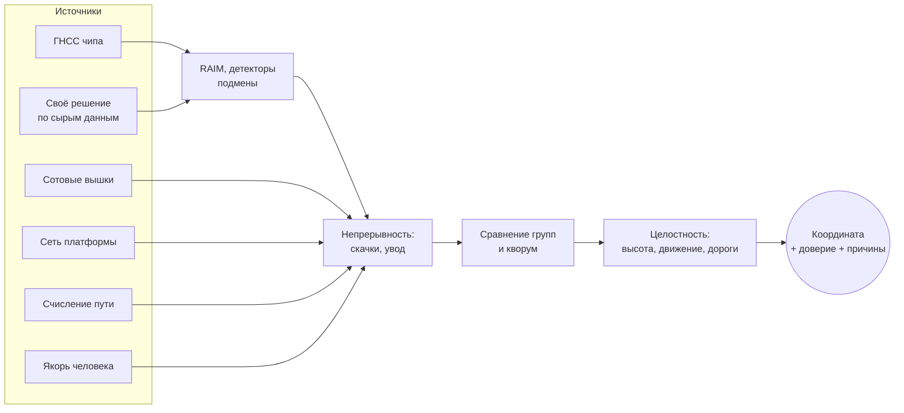

<p align="center">
  
</p>

<h1 align="center">BK-PHENIX</h1>

<p align="center">
  <b>Надёжная координата при глушении и подмене ГНСС</b><br>
  Android · Kotlin · Jetpack Compose · без Google Play Services
</p>

<p align="center">
  <a href="https://github.com/BobbyUDLab/BK-PHENIX/actions/workflows/ci.yml"></a>
  
  
  
  
</p>

---

В Москве GPS регулярно подменяют: телефон «уезжает» к Шереметьево, едет там 100 км/ч по кругу на высоте
800 м над землёй, а ГЛОНАСС, Galileo и BeiDou в это время глушат. Обычные карты верят такой точке.

**BK-PHENIX не верит одному источнику.** ГНСС, собственное решение по сырым измерениям, сотовые вышки, Wi-Fi,
датчики движения, рельеф, барометр, дороги и якорь, поставленный человеком, сверяются между собой.
Подменённое отсекается, а приложение честно показывает, насколько можно доверять точке и почему.

## Возможности

| | |
|---|---|
| 🛰 **Контроль ГНСС** | собственное решение МНК по сырым измерениям (GPS, Galileo, ГЛОНАСС, BeiDou), RAIM/FDE и HPL, чётность GPS LNAV, запасные эфемериды RINEX |
| 🕵️ **Детекторы подмены** | «GPS против других систем», одинаковый C/N0, L1/L5, скачки часов, АРУ, NITZ, сверка с сетью, скачки и плавный увод (Калман + CUSUM) |
| ⛰ **Высота и движение** | запрет ГНСС при грубой ошибке высоты (рельеф Copernicus + геоид + барометр), сверка с шагами, покоем и гироскопом |
| 📡 **Вышки офлайн** | база Москвы и области: 1 млн сот OpenCelliD + MLS и 59 тыс. базовых станций LTE; своя обучаемая база, которая исправляет ошибки краудсорсинга |
| 🧭 **Счисление пути** | инерциальная навигация по датчикам: держит позицию в тоннеле и при потере ГНСС |
| ⚓ **Якорь человека** | точка, поставленная или подтверждённая вами, — доверенный источник; на остановках приложение предлагает подтвердить место |
| 🗺 **Офлайн-карта** | PMTiles, поворот «по курсу» (компас пешком, курс движения в машине), привязка к дорогам OSM |
| 📈 **Трек и журнал** | одна кнопка пишет трек (GPX) и полный журнал (GnssLogger + JSONL с решением ядра); повтор журналов на ПК |

## Как принимается решение



- **Независимость.** Источники делятся на группы: сеть платформы и счисление от фикса ГНСС «повторяют» ГНСС и
  не подтверждают её. «Надёжно» — только когда итог подтверждают две независимые группы.
- **Честная погрешность.** Показывается круг 95 % (не меньше ≈5 м), а цвет и подпись говорят, можно ли верить точке.
- **Объяснимость.** На первом экране — кто подтвердил итог, кто отброшен и какие детекторы сработали.

## Экраны

- **Координата** — карточка позиции (доверие, координаты, точность, подтверждения, якорь) и «Как принято решение».
- **Карта** — переключатели значками, компас, слои (рельеф, дороги, файл карты), панель скорости с расхождением
  высоты и расстоянием до дороги, якорь перекрестием, запись трека.
- **Спутники** — системы, частоты, C/N0, RAIM и исключённые спутники.
- **Диагностика** — решение ядра целиком, детекторы, запреты ГНСС, датчики, счисление, вышки и своя база,
  экспорт/импорт, журналы.

## Проверено в поле

| Устройство | Что видно |
|---|---|
| Huawei Mate 70 Pro (PLR-L29) | сырые измерения всех систем, подмена GPS L1 у Шереметьево, две SIM |
| Huawei P30 lite | без SIM и сети: только датчики, высота и асимметрия систем |
| DOOGEE V Max (Android 12) | другой ГНСС-модуль: паузы в фиксах, сторож GPS |

Отчёты с цифрами: [04.11](docs/real-logs-2026-11-04.md) · [08–12.11 → 0.8.1](docs/field-tests-2026-11-08-12.md).

## Сборка

Нужны JDK 17+ (подойдёт `jbr` из Android Studio) и Android SDK (`platforms;android-35`, `build-tools;35.0.0`,
путь — `ANDROID_HOME` или `local.properties`). База вышек хранится в Git LFS: `git lfs install` перед клонированием.

```bash
./gradlew :core:test           # тесты ядра (JUnit 5)
./gradlew testDebugUnitTest    # тесты приложения
./gradlew assembleDebug        # app/build/outputs/apk/debug/app-debug.apk
```

На Windows: `.\gradlew.bat test assembleDebug`. CI собирает debug APK на каждый PR (артефакт `bk-phenix-debug-apk`).

Инструменты на ПК (`:tools`):

```bash
./gradlew :tools:replay --args="gnss_log_*.txt --nav BRDC*.rnx.gz"   # контроль ГНСС по журналу GnssLogger
./gradlew :tools:learnCells --args="learned.bklc phenix_*.jsonl"     # своя база вышек из журналов
python3 tools/celldb/build_cell_db.py <выход.bin.gz> 250.csv.gz <MLS или старая база>
```

## Структура

| Модуль | Что внутри |
|---|---|
| `:core` | чистый Kotlin/JVM: наблюдения и группы независимости, компаратор, целостность, ГНСС (эфемериды, WLS, RAIM, детекторы), вышки, счисление, якорь, рельеф, дороги, трек |
| `:app` | Android (minSdk 26, targetSdk 35), Compose + Material 3, foreground-сервис, MapLibre, Room |
| `:tools` | повтор журналов, обучение базы вышек, сборка базы вышек |

## Документация

[Концепция](concept.md) · [План укрепления ядра](docs/roadmap.md) · [Валидация](docs/validation.md) ·
[Данные и лицензии](docs/data-licenses.md) · [История изменений](CHANGELOG.md) · [Название и логотип](docs/brand/README.md)

## Данные и атрибуция

- Сотовые вышки: **OpenCelliD** — *OpenCelliD Project is licensed under a Creative Commons Attribution-ShareAlike
  4.0 International License* (производная база распространяется на тех же условиях) и **Mozilla Location Service**
  (CC0 1.0).
- Дороги: © участники **OpenStreetMap**, ODbL 1.0.
- Рельеф: **Copernicus DEM GLO-90** — *© DLR e.V. 2010-2014 and © Airbus Defence and Space GmbH 2014-2018 provided
  under COPERNICUS by the European Union and ESA; all rights reserved*. Геоид EGM2008 (NGA) — общественное достояние.

Подробности и состав — в [docs/data-licenses.md](docs/data-licenses.md).

## Разработка

- Ветки `feat/*`, `fix/*`, `docs/*`; в `main` — только через PR с зелёным CI.
- Коммиты в стиле [Conventional Commits](https://www.conventionalcommits.org/ru/) на русском: `feat(core): …`, `fix(app): …`.
- Изменения поведения ядра проверяются на реальных журналах и тестах сценариев (`core/src/test/.../validation`).
