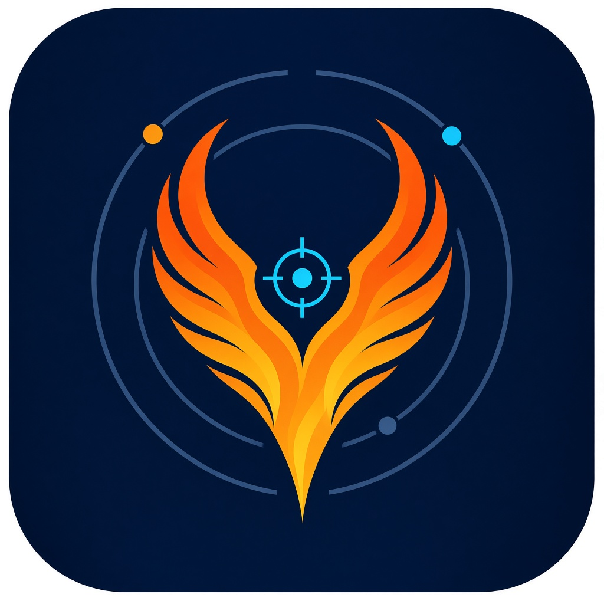

# BK-PHENIX

[](https://github.com/BobbyUDLab/BK-PHENIX/actions/workflows/ci.yml)

Android-приложение для надёжного определения координат при глушении и подмене ГНСС.
Все источники (ГНСС, сотовые вышки, Wi-Fi, BLE, датчики, рельеф) сверяются между собой,
ложные данные отсекаются, а погрешность показывается явно. Работает без Google Play Services.

Подробнее: [концепция](concept.md), [название и логотип](docs/brand/README.md).

## Структура

| Модуль | Что внутри |
| --- | --- |
| `:core` | Чистый Kotlin/JVM: модель наблюдений и источников, компаратор, контроль целостности (в т. ч. чётность GPS LNAV), якорь пользователя, `PhenixCore`. JUnit 5. |
| `:app` | Android, Jetpack Compose + Material3, minSdk 26, пакет `ru.bkphenix`. Экран «Координата». |

## Требования

- JDK 17 или новее, включая JDK 25 из `jbr` Android Studio (байткод собирается под Java 17).
- Android SDK: `platforms;android-35`, `build-tools;35.0.0`. Путь берётся из `ANDROID_HOME` или `local.properties`.

## Сборка

```bash
./gradlew test             # юнит-тесты
./gradlew assembleDebug    # app/build/outputs/apk/debug/app-debug.apk
```

На Windows: `.\gradlew.bat test assembleDebug`.

CI собирает debug APK на каждый PR и пуш в `main`; APK лежит в артефакте `bk-phenix-debug-apk`.

## Правила разработки

- Ветки `feature/*`, `fix/*`; изменения в `main` только через PR с зелёным CI.
- Коммиты в стиле [Conventional Commits](https://www.conventionalcommits.org/ru/) на русском: `feat(core): …`, `fix(app): …`, `docs: …`.

## Этап 2: сбор данных (без GMS)

Приложение использует только AOSP API — работает на Huawei/Honor без Google-сервисов:

| Источник | API | Куда идёт |
|---|---|---|
| GNSS / сеть | `LocationManager` (gps, network, passive) | наблюдения ядра |
| Спутники | `GnssStatus`, `GnssMeasurementsEvent`, `GnssCapabilities` | экран «Спутники» |
| Навсообщения | `GnssNavigationMessage` (GPS LNAV) | проверка чётности IS-GPS-200 |
| Соты | `TelephonyManager.getAllCellInfo` | `CellLocator` (офлайн-база — этап 4) |
| Wi-Fi / RTT, BLE | `WifiManager`, `WifiRttManager`, `BluetoothLeScanner` | диагностика (базы — этапы 4–5) |
| Датчики | `SensorManager` | диагностика |
| Время сети | `SystemClock.currentNetworkTimeClock` (API 33+) | сверка времени с GNSS |

Сбор идёт в foreground-сервисе (`location`). Урезанные прошивкой API деградируют до статуса
«не поддерживается», а не до падения. Экраны: «Координата», «Спутники», «Диагностика».

## Этап 3: контроль целостности по сырым данным ГНСС

Ядро (`core/gnss`) строит собственное решение независимо от решения чипа:

1. **Эфемериды** — подкадры 1–3 GPS LNAV из `GnssNavigationMessage` (`LnavDecoder`, `EphemerisStore`), положение и часы спутника по IS-GPS-200.
2. **Псевдодальности** — из `GnssClock`/`GnssMeasurement` по методике Android Raw GNSS (`Pseudoranges`).
3. **Решение МНК** (`WlsSolver`) — Гаусс–Ньютон с поправкой Саньяка, тропосферой и весами по C/N0 и углу места.
4. **RAIM/FDE** (`Raim`) — тест χ² по невязкам, исключение до двух спутников, оценка HPL.
5. **Детекторы подмены** (`SpoofingMonitor`) — одинаковый C/N0, согласованность L1/L5, скачки часов приёмника,
   сверка с сетевой позицией и NITZ, АРУ против C/N0, решение чипа против собственного.

Статус RAIM, исключённые спутники и детекторы — на экране «Спутники».

Ограничения: решение только по GPS L1 C/A (эфемериды Galileo/BeiDou/ГЛОНАСС не разбираются),
без ионосферной модели Клобучара (ошибка до ~10 м учтена в весах), RAIM работает, только если чип
отдаёт и сырые измерения, и навигационные сообщения.
