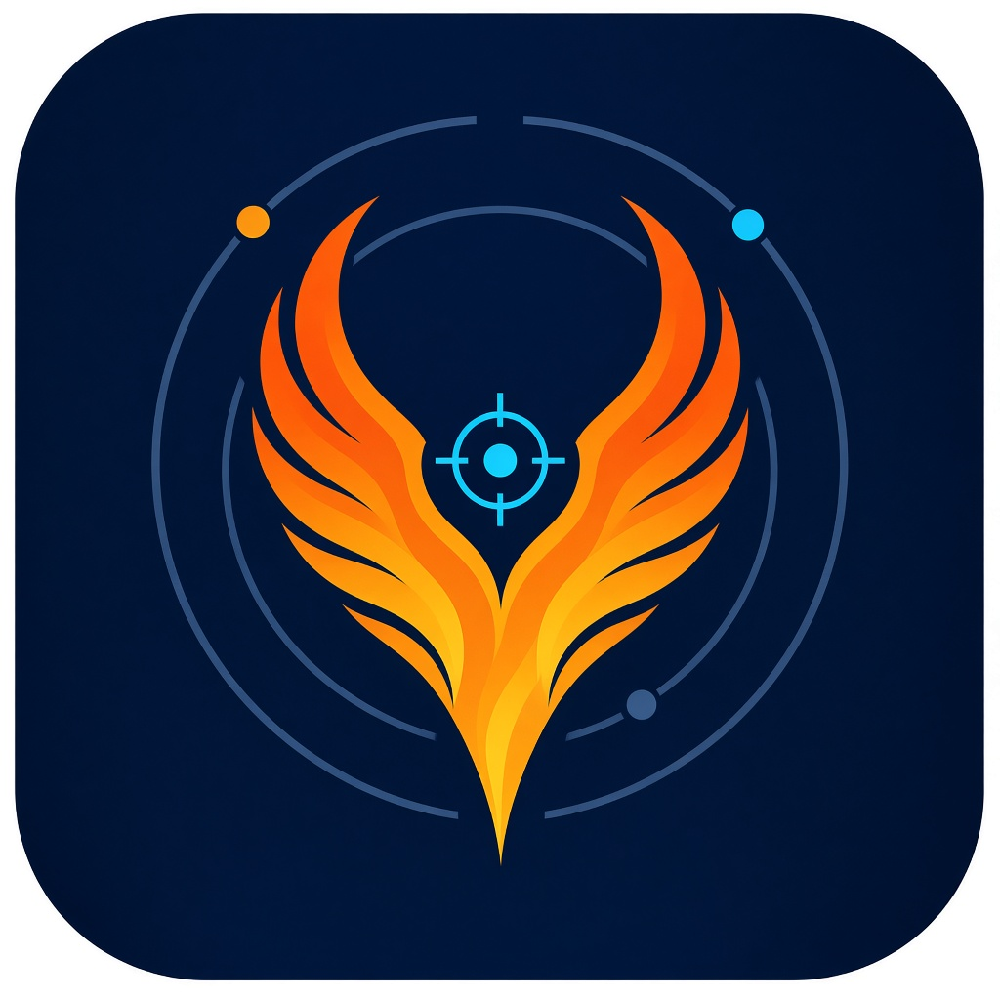

# Бренд BK-PHENIX

## Название
**BK-PHENIX — Positioning Hybrid Evaluation, Navigation Integrity & eXclusion**

| Буква | Значение | Что делает приложение |
|---|---|---|
| **P** | Positioning | определяет местоположение |
| **H** | Hybrid | объединяет GNSS, сотовые сети, Wi-Fi и датчики |
| **E** | Evaluation | оценивает каждый источник и итоговую погрешность |
| **N** | Navigation | ведёт по треку и к точке |
| **I** | Integrity | контролирует целостность данных (чётность, RAIM) |
| **X** | eXclusion | исключает ложные и подменённые источники (FDE) |

Внутренняя архитектура ядра называется **PHASE — Positioning Hybrid Accuracy, Safety & Integrity Engine**.

Второй смысл названия:
- **PHENIX** — от феникса, птицы, которая возрождается из пепла. Так же ведёт себя приложение: когда GNSS заглушен или подменён и координата «сгорает», BK-PHENIX восстанавливает её из других источников (сотовые сети, Wi-Fi, датчики, якорь пользователя) и продолжает работать.
- Написание **PHENIX** вместо PHOENIX — короче, легко читается и уникально для поиска и регистрации.
- **BK** — авторская подпись проекта.

## Логотип
- **Крылья феникса** складываются в форму метки на карте: возрождение и местоположение в одном знаке.
- **Прицел в центре** — точная, проверенная координата, главная ценность приложения.
- **Орбиты с точками** — спутники разных систем (GPS, ГЛОНАСС, Galileo, BeiDou), которые сверяются между собой.
- **Цвета:** тёмно-синий — ночь и надёжность, оранжево-золотой — огонь феникса, голубой акцент — достоверная точка.
